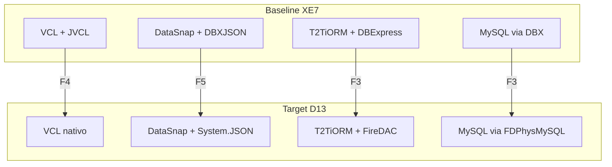
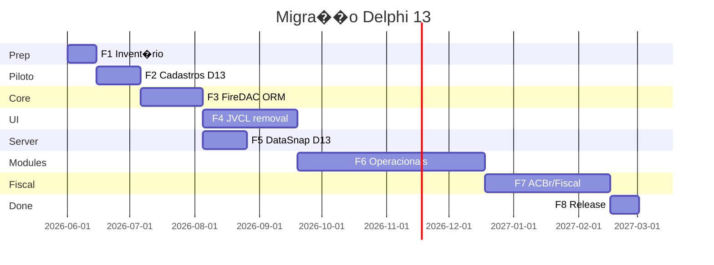

# Migra��o Delphi 13 � Design

**Spec:** `.specs/features/delphi-migration/spec.md`  
**Context:** `.specs/features/delphi-migration/context.md`  
**Status:** Draft � aguardando decis�es ACBr e Loja Virtual

---

## Architecture Overview

A migra��o preserva a arquitetura **Cliente ? DataSnap ? Comum/Controller ? ORM ? DB**, substituindo camadas de infraestrutura por equivalentes nativos Embarcadero.



---

## Code Reuse Analysis

### Existing Components to Leverage

| Component | Location | How to Use |
|-----------|----------|------------|
| Controllers (295) | `Comum/Controller/` | Manter l�gica; apenas adaptar se ORM interface mudar minimamente |
| VOs (~400) | `Comum/VO/` | Reutilizar 100% � sem depend�ncia de DBExpress |
| Dispatcher RTTI | `Servidor/Controller.pas` | Manter; trocar JSON layer |
| Telas base | `Cliente/Comum/Tela/` | Migrar JVCL ? VCL aqui (impacto cascata positivo) |
| AFV/NFC-e parcial FireDAC | `Cliente/AFV/`, `NFC-e Mobile/` | Refer�ncia para padr�o FireDAC |

### Fragile Areas (from CONCERNS.md)

| Area | Mitigation in Migration |
|------|-------------------------|
| `T2TiORM.pas` global singleton | Introduzir `TFDConnection` pool-ready; testar CRUD antes de migrar m�dulos |
| God units (`UNFe.pas`) | N�o refatorar na migra��o; apenas compilar � refactor p�s-F7 |
| Duplica��o (`UProduto`, `UMenu`) | Consolidar durante F6 (m�dulo a m�dulo) |
| MD5 auth | Corrigir durante F5 (side benefit) |

---

## Dependency Replacement Matrix

| Depend�ncia | Ocorr�ncia | Substituto nativo D13 | Fase |
|-------------|------------|----------------------|------|
| DBExpress / `TSQLConnection` | `Comum/`, 96 conn files | **FireDAC** `TFDConnection` | F3 |
| Devart PostgreSQL | `UDataModuleConexao.pas` | **FireDAC** `TFDPhysPgDriverLink` | F3 |
| Zeos `ZComponent` | AFV `.dproj` | **FireDAC** | F3/F6 |
| JVCL `Jv*` | ~200+ `.pas`, todos `.dproj` | **VCL** `TDBGrid`, `TPanel`, etc. | F4 |
| FastReport `frx*` | 3 `.pas`, 15 `.fr3` | **QuickReport** ou PDF nativo | F4/F7 |
| DBXJSON | `Controller.pas`, `JSonVO.pas` | **System.JSON** | F5 |
| FastMM4 | `T2Ti_ServidorAplicacao.dpr` | Remover (default MM) | F5 |
| mORMot/Synopse | `SM/` | **Descontinuar** | F6 |
| IntraWeb | `.dproj` packages | Remover | F2+ |
| Rave Reports | `.dproj` legacy | Remover | F2+ |
| Indy | HTTP/DataSnap | **Manter** (nativo Delphi) | � |
| DataSnap | Servidor/Cliente | **Manter** (validar D13 API) | F5 |
| ACBr | Fiscal (massivo) | **DECIS�O** � ver context.md | F7 |
| uniGUI | Loja Virtual | **DECIS�O** � descontinuar ou isolado | F8 |

Detalhamento: `.specs/features/delphi-migration/dependency-matrix.md`

---

## Component Design: FireDAC Adapter Layer

### Purpose

Minimizar impacto nos 295 controllers ao trocar DBExpress por FireDAC.

### Location

- `Comum/DataModule/UDataModuleConexao.pas` � refatorado
- `Comum/T2TiORM.pas` � refatorado
- **Novo:** `Comum/DataModule/UDataModuleConexao.dfm` � `TFDConnection`, `TFDPhysMySQLDriverLink`

### Interface (preservar contratos)

```pascal
// Manter fun��es p�blicas existentes:
procedure Conectar(pSGBD: string);
function ConfigurarConexao(pSGBD: string): Boolean;
// T2TiORM m�todos: Inserir, Alterar, Excluir, Consultar, ComandoSQL
```

### Internal change

| DBExpress | FireDAC |
|-----------|---------|
| `TSQLConnection` | `TFDConnection` |
| `TSQLQuery` | `TFDQuery` |
| `TDBXCommand` | `TFDCommand` ou `TFDQuery.ExecSQL` |
| `MySQL_DBExpress_conn.txt` | `MySQL_FireDAC.ini` (formato FDDefinition) |

### Config file format (proposto)

```ini
[MySQL]
DriverID=MySQL
Server=localhost
Database=t2tierp
User_Name=app_user
Password=
CharacterSet=utf8mb4
```

---

## Component Design: JVCL ? VCL Grid Migration

### Primary target

`JvDBUltimGrid` em `Comum/Biblioteca.pas` e `Cliente/Comum/Tela/UBase.pas`

### Strategy

1. Inventariar features JVCL usadas (sort, filter, export, hints)
2. Mapear para VCL nativo:
   - `TDBGrid` + `TFDQuery` + `TDataSource`
   - Opcional: `TStringGrid` para grids n�o-DB
3. Criar unit `Comum/VclGridHelpers.pas` com fun��es equivalentes a helpers JVCL em `Biblioteca.pas`
4. Migrar telas base primeiro ? cascata para 200+ telas

---

## Component Design: JSON Migration

### Files affected

- `Servidor/Controller.pas`
- `Cliente/Comum/Controller.pas`
- `Comum/JSonVO.pas`
- `Comum/Conversor.pas`

### Strategy

1. Criar `Comum/JsonCompat.pas` � wrapper tempor�rio se necess�rio
2. Substituir `TJSONObject` DBXJSON por `System.JSON.TJSONObject`
3. Adaptar `JSonVO` RTTI serialization
4. Testar round-trip: VO ? JSON ? VO via DataSnap

---

## Migration Sequence (critical path)



*Dura��es estimadas � ajustar com velocidade real da equipe.*

---

## Rollback Strategy

| Fase | Rollback |
|------|----------|
| F2 Piloto | Tag `pre-f2-cadastros`; branch separada |
| F3 FireDAC | Feature flag `Conexao.ini` ? modo DBExpress (branch XE7 paralela at� F3 validado) |
| F4+ | Tag por m�dulo migrado; manter XE7 buildable at� F8 |

---

## Risks

| Risk | Impact | Mitigation |
|------|--------|------------|
| ACBr incompat�vel D13 | Fiscal parado | Validar ACBr trunk cedo; decis�o context.md |
| T2TiORM refactor quebra controllers | Total | Testes CRUD; migrar servidor primeiro |
| JVCL features sem equivalente VCL | UI degradada | Invent�rio feature-parity antes F4 |
| DataSnap API changes D13 | Clientes n�o conectam | Spike F5 antes de F6 massivo |
| uniGUI blocking | Loja Virtual offline | Descontinuar temporariamente |

---

## Open Questions

1. ACBr: manter ou reescrever? ? `context.md`
2. Win64 na v1 ou s� Win32? ? Propor Win32 first
3. Consolidar Cadastros+CadastrosM durante F2 ou F6?
